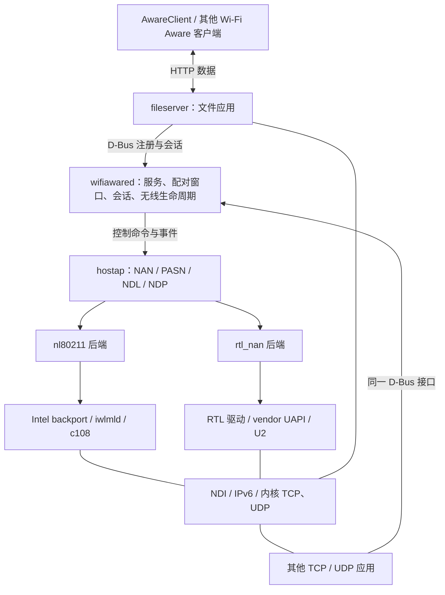

# Wi-Fi Aware 组件架构

采用单仓库、公共用户态组件、独立硬件适配的结构。`wifiawared`、hostap、文件服务和 iOS 客户端各维护一份源码；BE200 与 RTL8852BE 的驱动、固件、无线接口差异分别放入硬件目录。新增网卡扩展硬件适配，业务应用继续使用相同的服务接口。

公共实现以 2026-11-01 核对的两个远端 `main` 为来源：

| 来源 | 提交 | 路径 |
| --- | --- | --- |
| BE200 | `f0f35f48df6cf05ea3386efb765cb6260eb1b4fe` | `/Users/eki/Project/Embedded_Project/be200-wifi-aware` |
| RTL8852BE | `374fd0c5661853936d4a7603063080086c7b8354` | `/Users/eki/Project/AI/rtl8852be-wifi-aware` |

代码与固定上游来源共同维护于本仓库。

配置按部署选择、硬件策略、双端服务契约、构建与平台输入分别维护。文件布局、字段定义、加载顺序及状态边界见[配置架构](configuration.md)。

手工维护的配置项就地注明含义、单位、取值约束和缺省行为，文件注明生效方式；安装到目标机器的可编辑配置保留这些注释。

## 总体结构



图中的两个无线分支表示可选择的后端。一个守护进程管理一块网卡、一套 `nan0` / `ndi0`，支持多个上层服务。文件内容直接经过 NDI 和内核网络栈，D-Bus 与 `wifiawared` 只承载控制信息。

交付分成三个部分：公共 Linux 用户态、指定网卡的硬件包、使用公共接口的应用。文件服务可以独立安装和停用；其他应用直接注册 TCP / UDP 服务，无须引入文件协议。

公共 Linux 服务、公共库与构建安装工具采用 BE200 main 的 Rust workspace：Rust 2024 edition、最低工具链 1.93，依赖由 `Cargo.lock` 固定。hostap、RTL hostap 后端与内核驱动保持 C，iOS 使用 Swift。

## 现有基础

两个仓库共用 D-Bus、文件协议和 hostap 基线。BE200 main 已提供 Rust 实现及 ARM64 真机验收；RTL main 的公共服务仍基于 BE200 `10bb879` 的 C／Go 实现，另有已验证的 RTL 接入行为。公共源码以 BE200 当前 Rust 实现为准，RTL 的接管、事件、认证和清理差异按行为纳入。

| 部分 | 两个 main 的关系 | 合并方式 |
| --- | --- | --- |
| 公共库 | BE200 为 `aware-common` Rust crate；RTL 为 C 支持库 | 使用 `aware-common` 的 D-Bus 类型、系统调用和退出处理 |
| 文件服务 | BE200 为 Rust / Hyper / Tokio；RTL 为 Go；HTTP 契约共用 | 使用 Rust 文件服务，保留配置和会话授权语义 |
| 配置与 hostap 控制通道 | BE200 为 Rust 模块；RTL 为 C 实现 | 使用 BE200 的 TOML 配置与异步 Unix 控制通道 |
| hostap 基线与 `0001`–`0009` 补丁 | 内容相同，均为 2.12 | 统一来源、构建配置与补丁序列 |
| Publisher、进程与接口管理 | BE200 为 Tokio 串行无线任务；RTL 有事件驱动生命周期及认证、回收差异 | 在 Rust Publisher 中纳入有效行为，共用一套状态机 |
| 无线接入 | BE200 `radio.rs` 与 RTL `WADRadio.c` 均混合公共流程与芯片操作 | 使用公共 Rust Radio，提取两种硬件的接入操作 |
| 构建安装 | BE200 为 Rust `aware-build`；RTL 为 shell / Python / Make | 扩展 `aware-build` 调度两个硬件配方及既有固件工具 |
| AwareClient | 传输逻辑基本一致；发现过滤、超时、显示名称及 bundle 不同 | 共用源码和发现规则，保留部署身份 |

BE200 Rust 基线已记录配对、安全 NDP、双向文件、单／四连接下载、取消及服务重启验收。合并后的 RTL 接入与公共协议改动须分别完成对应真机验收。

## 目录与依赖

```text
wifi-aware/
├── Cargo.toml                     # 公共服务、公共库和构建工具 workspace
├── Cargo.lock
├── .cargo/config.toml
├── config/
│   ├── wifiawared.toml             # 无线服务运行默认值
│   ├── fileserver.toml             # 文件服务运行默认值
│   ├── fileserver-discovery.toml   # Linux / iOS 共用发现契约
│   └── local/                     # 本机持久构建与安装配置，不入 Git
├── components/
│   ├── common/                    # aware-common：D-Bus 类型与系统支持
│   ├── wifiawared/
│   │   ├── src/                   # Manager、Service、配对、会话、公共 Radio
│   │   │   ├── radio.rs           # 公共异步无线生命周期
│   │   │   └── backend.rs         # 内部后端选择及接入契约
│   │   ├── Cargo.toml
│   │   └── wifiawared.service
│   ├── hostap/
│   │   ├── source.json
│   │   ├── hostap.config
│   │   ├── patches/series
│   │   └── LICENSE.hostap
│   └── fileserver/                 # Rust / Hyper 文件应用及 systemd 单元
├── hardware/
│   ├── be200/
│   │   ├── radio.rs               # 设备匹配、接口接管与能力约束
│   │   ├── radio.toml             # 已验证的 NAN 启动和时隙策略
│   │   ├── driver/                # backport 来源、补丁、配置、安装规则
│   │   ├── firmware/              # c108、PNVM、来源与授权
│   │   └── README.md              # 能力、构建与已知限制
│   └── rtl8852be/
│       ├── radio.rs
│       ├── radio.toml
│       ├── hostap/                # rtl_nan、vendor netlink、NMI/NDI、调度
│       ├── driver/                # Radxa 基线、补丁、唯一 UAPI 头文件
│       ├── firmware/              # U2 基线、补丁、构建工具与交付镜像
│       └── README.md
├── platforms/
│   └── rock5b/                    # build.toml、usbmoded 关机配置
├── ios/
│   ├── AwareClient/               # 一份通用应用源码
│   │   └── Client.plist           # 客户端连接与 I/O 期限
│   ├── Configurations/            # bundle、显示名、签名设置
│   ├── AwareClient.xcodeproj/     # 保留现有安装身份的 scheme / 配置
│   └── AwareLab/                  # 已有真机诊断与验收工具
├── tools/
│   └── aware-build/                # Rust 源码准备、构建、授权收集和安装
├── scripts/                       # aware-build 启动入口
├── docs/                          # 公共架构、API、协议、验收结论
├── .build/                        # 可重建源码、构建与暂存产物
└── .private/                      # 私有证据与临时材料
```

`components/hostap` 负责协议栈，最终程序仍是 `wpa_supplicant`。现有 RTL `components/hostapd` 中的私有代码归入 `hardware/rtl8852be/hostap`；其中公共进程管理归入 `wifiawared`。

文件服务的组件目录为 `components/fileserver`，Cargo package 和可执行文件均为 `fileserver`，systemd 单元为 `fileserver.service`。

Rust `Publisher` 通过公共 `Radio` 操作无线设备；文件服务与 App 使用公开协议。`hardware/*/radio.rs` 作为 `wifiawared` 内部模块编入，通过 `backend.rs` 接入；RTL 的 C 适配编入独立 hostap 进程，通过 hostap 原生驱动接口使用内核 UAPI。两进程沿用 Unix 控制套接字通信。`common` 保持公共类型和系统支持职责。

## 两个明确的硬件边界

### 守护进程的无线接入

公共 Rust `Radio` 负责设备枚举、进程管理、控制套接字、日志、事件等待、NAN 启动流程、NDI 地址配置和资源所有权。

后端使用 Rust 枚举选择，两种实现静态编入同一个 `wifiawared`。接口为仓库内部接口，与公共代码一起构建。后端提供设备匹配、启动接口准备、引导接口退出方式、运行接口判定及硬件能力约束。NAN 启动值和本地时隙策略从对应 `radio.toml` 读取。

| 项目 | BE200 | RTL8852BE |
| --- | --- | --- |
| hostap driver | `nl80211` | `rtl_nan` |
| 接管接口 | 空闲 managed 接口；进入 NAN 后删除引导接口 | 保留物理控制接口及原厂未关联的 `p2p0` |
| 运行接口判定 | 所选 PHY 只允许 NAN / NAN_DATA | 物理控制接口与原生持久 NDI；逻辑 `nan0` 由后端承载 |
| 无线运行策略 | `hardware/be200/radio.toml` | `hardware/rtl8852be/radio.toml` |
| 资源释放 | hostap 接口与 nl80211 生命周期 | 原生 STOP、在途排空、站点和密钥释放 |

无线运行策略影响真实行为。RTL 后端会拒绝不符合其实现要求的启动参数；配置仅能选择后端已实现的能力。

设备选择共用一套逻辑：运行配置的 `pci` 优先；未指定时只在支持的候选中选择唯一设备，多个候选要求指定地址。PCI 和已加载驱动确定后端，所需无线能力由该后端的现有接口确认。接口名称从所选设备取得，数据频率由运行配置请求并经实际后端确认。

后端描述与公共流程保持分离：进程启动、日志任务、D-Bus、配对、文件传输由公共模块维护。

### hostap 的无线驱动接口

继续使用 hostap 已有的 `wpa_driver_ops`。同一份 `wpa_supplicant` 编入 nl80211 和 `rtl_nan`，由所选无线后端明确指定驱动。

NAN 发现、SAE/PASN、NIK/NPK、NDL/NDP、服务映射及协议调度协商由公共 hostap 负责。RTL 目录负责将 station、key、管理帧、NDI 和日程转换成 vendor command/event；Intel 走现有 nl80211 路径。

管理帧 TX 成功、站点授权和资源回收沿用实际完成语义。RTL 的在途引用、密钥所有权、排空失败和 STOP 处理保留在 RTL 后端及驱动中。

## 公共状态与接口

### 就绪和退出

启动顺序为：选定设备 → 接管空闲接口 → 启动 hostap → 控制接口就绪 → NAN 合簇和本地日程建立 → 持久 NDI 与 IPv6 就绪 → 取得 D-Bus 名称。

公共状态管理沿用 BE200 的 Tokio 串行 Publisher 任务：zbus 方法通过消息通道提交变更，属性读取共享快照。锁只覆盖共享状态访问，异步 I/O 在锁外执行。

进程和退出信号使用 Tokio 的子进程等待与信号通知；接口 netlink 事件和控制套接字文件就绪接入异步 fd。正常退出同时等待 hostap 和其网络接口释放，接口占用以内核接口表为准。RTL 已验证的事件驱动行为在这个运行时内实现。合簇、日程安装、子进程退出和停止由事件推进；协议期限使用对应截止时间唤醒。日程因簇变化失效时，由新的合簇事件推进重新安装。

`Type=dbus` 继续作为上层就绪条件。文件服务在无线服务就绪后绑定监听、注册服务，并维护会话快照。退出时按服务注销、NDP 结束、无线资源释放和进程退出完成清理；回收失败必须保留错误状态。

服务注册、配对窗口、NDP、TCP 连接分别拥有生命周期。关闭配对窗口保留服务和现有传输；注销单个服务只回收该服务资源；共享邻居在最后一个使用它的会话结束后删除。

### 对外契约

继续使用现有 D-Bus `Manager` / `Service` / `ObjectManager`，两个 Rust 服务均通过 zbus 连接 system bus。文件应用使用 Hyper HTTP/1.1，保留 IPv6、HEAD、单范围与 multipart 多范围、修改时间条件请求、PUT 和取消语义。

| 标识或状态 | 决定 |
| --- | --- |
| D-Bus 名称与对象根 | 保留 `org.be200.WiFiAware1` 和 `/org/be200/WiFiAware1` |
| 文件服务发现名 | 默认由 `config/fileserver-discovery.toml` 定义 `_rtl8852be-test._tcp`，两端同源；其他应用注册自己的服务名 |
| Linux 配置与配对目录 | 保留 `/etc/wifiawared`、`/var/lib/wifiawared` |
| 运行目录 | 保留 `/run/wifiawared` |
| 文件配置和共享目录 | 沿用已有部署配置，安装时只创建缺失的默认配置 |
| 设备厂商和型号展示 | 从无线服务配置的 `identity` 段取得；客户端按服务发现 |

这些名称已被两个项目共同使用，作为现有接口标识继续生效。标准组件的复用边界由接口和职责确定。

`SupportedRoles`、`SupportedTransports`、`SupportsMultipleServices` 等现有属性继续表达应用契约。多服务、多个 NDP 和多个物理数据站点分别处理；资源不足由对应后端返回实际错误。新增硬件的能力通过协议栈和驱动上报。

### 超时与认证

控制阶段失败期限与业务 I/O 空闲期限分开维护。前者按明确完成事件及已有实测预算设置；后者表示允许业务流多长时间没有进展。

控制期限位于无线服务配置的 `timeouts` 段；服务端传输空闲期限位于文件服务配置；客户端连接与 I/O 期限位于 `Client.plist`。字段与默认来源见[配置架构](configuration.md)。

统一客户端保留 60 秒 I/O 空闲期限，文件服务的新安装默认值同为 60 秒。现有安装的 `io_timeout` 不被覆盖。BE200 已记录约 19.7 秒的 Aware TCP 停顿，60 秒约为该观测的三倍，能够容纳该用法。持续吞吐和无停顿目标仍按原计量方式判断。

客户端连接建立期限与 I/O 空闲期限分别定义。控制操作的具体预算以对应阶段的双卡验收结果确定，避免将 RTL 的 5 秒和 BE200 的较长预算混作一个全局常量。

缓存认证采用公共 hostap 的本地已提交日程处理；对端能力继续约束 NDP 准入。认证流程、补丁和事件循环作为一个完整改动在两种网卡上验收。

## 来源、构建与交付

### 一份协议栈

hostap 2.12 的来源清单、配置、授权和补丁统一放入 `components/hostap`。公共序列纳入现有 `0001`–`0009`，并整合 RTL 的对端能力事件、缓存认证本地日程和 NDC 实际信道覆盖修复。RTL 驱动注册属于该协议栈的构建接入，私有实现仍在硬件目录。

准备源码默认使用固定上游来源；支持显式提供已有归档。第三方展开源码、下载包和编译产物进入 `.build`，依赖版本保持固定。来源或补丁变化直接比较现有输入内容，决定是否重建。

### 共用入口、独立硬件配方

使用 BE200 的 Rust `aware-build` 作为源码准备、构建、授权收集和安装的统一实现。现有脚本保持命令入口职责，硬件命令增加目标参数：

```text
scripts/build-hostap.sh
scripts/build-publisher.sh
scripts/build-fileserver.sh
scripts/build-driver.sh be200|rtl8852be
scripts/install-publisher.sh
scripts/install-fileserver.sh
scripts/install-driver.sh be200|rtl8852be
```

公共用户态构建不选择芯片，同一架构的产物包含两个后端。驱动构建和安装显式选择硬件，继续接受目标内核、工具链和 `DESTDIR`。

板级构建选项由 `platforms/<name>/build.toml` 拥有，本机工具链和 headers 路径由 `config/local/build.toml` 拥有；aware-build 统一解析目标后交给硬件配方。地区相关模块参数来自 `config/local/install.toml`。本机配置长期保留，构建清理只处理可重建产物。

Rust 服务使用 `cargo build --locked`，通过 `CARGO_BUILD_TARGET` 和对应 linker 指定目标。构建保留依赖授权原文、版本及 Rust 标准库版权的收集与安装。RTL 固件构建沿用已验证的 Python / MIPS 工具，由硬件配方调用。

对象和产物按目标架构隔离，内核产物再按网卡和内核版本隔离。hostap 的配置及会被构建修改的源码目录也按编译目标隔离，避免 ARM64 和 amd64 交叉覆盖。

| 硬件包 | 构建与安装内容 |
| --- | --- |
| BE200 | 固定 backport、配套七个模块、c108 / PNVM、模块参数；保留现有内核版本及 Secure Boot 安装检查 |
| RTL8852BE | 固定 Radxa 基线、驱动补丁、U2 补丁生成与嵌入、`8852be.ko`、模块参数；保留固件数组和下载长度核对 |

RTL 固件格式要求的摘要重算和既有基线校验属于现有固件构建契约，随工具保留。

NetworkManager 规则围绕所选 PCI/PHY 及实际接口生成。板级 `usbmoded` 关机依赖放在 ROCK 5B 平台目录，随明确的板级部署步骤安装。普通用户态安装不承担板级系统配置。

### iOS 部署身份

AwareClient 使用一份 Swift 源码、一套服务名发现规则和一个项目。现有两个安装身份通过 scheme / 构建配置保留，运行逻辑相同，均可连接两种网卡：

| 已有安装 | Bundle ID |
| --- | --- |
| BE200 AwareClient | `com.eric3u.rtl8852be.AwareLab` |
| RTL AwareClient | `com.eric3u.rtl8852be.AwareClient` |
| RTL AwareLab 诊断工具 | `com.eric3u.rtl8852be.AwareLabRTL` |

现有签名团队、bundle 和系统配对记录保留。Linux 身份文件留在各自设备的状态目录中。新安装默认使用 AwareClient 身份；已有安装继续使用对应配置升级。

服务名由共用契约生成应用声明，Swift 读取生成的资源。bundle、显示名与签名设置由 `Configurations` 中的 xcconfig 管理；客户端运行策略由 `Client.plist` 管理。

## 新增网卡

新增 `hardware/<name>`，提供设备匹配和无线启动差异、驱动来源与补丁、固件及安装配方。能够满足现有 hostap nl80211 契约的设备直接复用该后端；使用私有 UAPI 的设备实现 hostap 原生驱动接口。

接入要求是可用的 NAN 发现、配对与安全 NDP、持久 NDI、站点和密钥生命周期、真实完成事件及可回收的停止流程。只支持发现的网卡可以如实记录其能力，不能作为完整数据后端交付。

注册新后端和构建目标后，沿用公共配对、服务注册、会话、文件传输和客户端。若新硬件需要扩展公共行为，扩展必须对应实际能力或协议差异。

## 验收

组件构建、暂存安装与实机结果见[验证与已知限制](acceptance.md)。硬件专项工具位于对应硬件目录，公共客户端和设备验收入口位于 ios。文件内容直接比较字节，设备现有配对和共享数据保留。

公共协议变更覆盖两个后端，硬件私有改动覆盖对应设备。吞吐对照固定方向、文件大小、频率、带宽、连接数和计时范围。

## 已知问题与限制

- 首版管理一块活动网卡。现有全局 D-Bus 名称、接口名、状态目录和 RTL 单 radio 实现都按此工作；指定 PCI 用于选卡。
- BE200 backport 会替换系统共享的 cfg80211 / mac80211。两个用户态后端共存不构成两套内核驱动同时加载的兼容结论，硬件包按目标机器安装。
- RTL 当前只有一个活动数据站点，不支持活动站点原位重键。多服务共享该站点，不据此声明多对端并发能力。
- 公共用户态支持 ARM64 与 amd64 Linux 构建。RTL 当前驱动配方和真机基线依赖 ROCK 5B / ARM64。
- BE200 Rust 真机验收记录了持续低速 NDP，以及两次客户端连接超时，触发原因未定位；Rust 服务的 30 分钟持续压力验收尚未完成。这些事项随基线保留。
- BE200 固件覆盖已验证的 C0 / c108；同一 PCI ID 不代表其他 stepping 已完成适配。RTL U2 的可用范围沿用现有固件约束。
- 两种硬件已有的组管理帧接纳保护限制、无线调度限制及性能未完成项继续随硬件文档记录。90 MB/s 等既有性能目标保持原定义。
- 两个 App bundle 的系统授权分别保留。源码共用不会合并系统授权，也不会把两台设备的 Linux 配对数据库合成一份。
